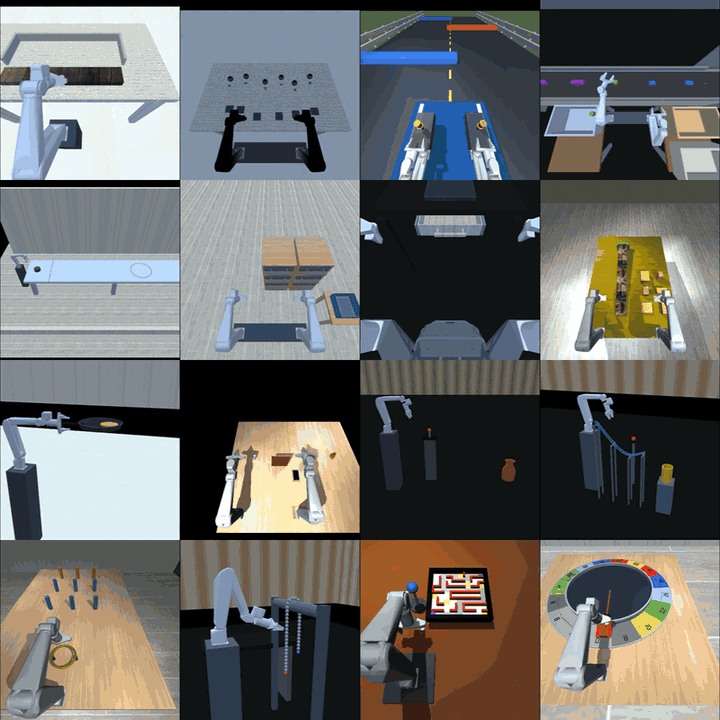

<p align="center"></p>

[English](README.md)

ReAct-Manip 是基于 MuJoCo 的机器人操作环境，用于检验策略能否利用交互反馈，在多个操作回合中持续适应。项目提供 16 项任务、统一的策略接口、任务默认评测，以及用户外部 manifest 重放能力。

<p align="center"></p>

> **公开版范围：** 本仓库不包含评测题库、固定 benchmark 实例或已报告的基线成绩。任务默认配置和显式传入的外部 manifest 仅用于开发评测，不能表述为仓库内置正式 benchmark 的成绩。

## 安装

ReAct-Manip 需要 Python 3.10。源码开发环境的安装方式如下：

```bash
python3.10 -m venv .venv
source .venv/bin/activate
python -m pip install -r requirements.txt
python scripts/build_agilex_assets.py
```

资产构建器首次运行时会下载经过摘要校验的上游 PiPER-X 文件。RGB 评测需要 OpenGL 后端；无显示器的 Linux 环境通常需要 EGL 或 OSMesa。

通过 PyPI 安装完整包时，执行 `python -m pip install 'react-manip[assets,demo]'`，然后首次使用前运行一次 `react-manip-assets prepare` 以准备 PiPER-X 资产。

## 协议与计分

每个 Task Instance 固定其任务级参数。策略经历所选任务协议定义的练习和考试 Episode；当协议允许时，策略可以保留状态并持续适应。进入下一个 Task Instance 时重新创建策略。一个 Episode 内的参数保持不变，显式 replay manifest 可恢复其保存的初态。

以下四项任务会在 Episode 之间改变物理条件：

| 任务 | 跨 Episode 变化 |
| --- | --- |
| `leveling_board1` | 垫片尺寸和薄轴方向 |
| `conveyor_grasp` | 传送带速度和目标物尺寸 |
| `box_insertion` | 接触摩擦和木块质量 |
| `car_drive2` | 车辆速度增益 |

任务规则、采样范围、计分实现和实例契约以各任务的 `task_spec.json`、`instance_contract.json` 为准。公开包不内置题库；如需 replay，必须由调用者显式提供外部 manifest 或候选库。

## 评测策略

将 `my_policy.py` 放在仓库根目录或 Python 导入路径下，然后运行安装后的任务默认配置评测：

```bash
react-manip-evaluate \
  --task box_insertion \
  --policy my_policy:build \
  --out outputs/box_result.json
```

在源码仓库中可使用相同参数运行 `python scripts/evaluate_policy.py`。基础链路检查可加 `--state-only-smoke` 和较短的 `--horizon-sec`；未提供 `--policy` 时使用随机动作。

CLI 不会隐式选择数据源。要重放仓库外维护的数据，必须显式传入外部 manifest 或候选库：

```bash
react-manip-evaluate \
  --manifest /path/to/suite/manifest.json \
  --policy my_policy:build \
  --out outputs/replay.json

react-manip-evaluate \
  --candidate-bank /path/to/external-bank.json \
  --draw-seed 42 \
  --policy my_policy:build \
  --out outputs/bank_result.json
```

外部 manifest 和候选库会在执行前校验。结果文件及生成的选择目录必须使用新路径。评测器限制墙钟运行时间，超时会使相应结果无效；仿真时间只随控制步推进，不受模型推理时长影响。

## 外部策略接口

下面的零动作策略仅展示接口，不会完成任务：

```python
# my_policy.py
import numpy as np

class ModelPolicy:
    policy_id = "my-model"

    def set_action_dim(self, action_dim):
        self.action_dim = action_dim

    def reset(self, *, seed=None, task_spec=None):
        pass

    def begin_episode(self, *, phase, episode_index, seed, task_spec):
        pass  # 可保留跨练习和考试回合的学习状态。

    def act(self, observation, info):
        return np.zeros(self.action_dim, dtype=np.float32)

    def end_episode(self, **feedback):
        pass

def build():
    return ModelPolicy()
```

`build()` 必须返回新的策略对象。动作须为长度 `action_dim` 的有限数值向量，范围 `[-1, 1]`；不合法动作使该组无效。任务指令来自 `info["language_prompt"]`，策略图像来自 `observation["images"]`。动作布局由记录中的机器人确定。实例文件和特权几何 Feature 不属于策略输入；公开赛道拒绝 `requires_geometry_truth=True`。

## 任务

| 任务 ID | 内容 | 任务 ID | 内容 |
| --- | --- | --- | --- |
| `curling_push` | 推冰壶 | `button_indicator_matching` | 按钮与指示灯匹配 |
| `phone_lean` | 手机支撑摆放 | `leveling_board1` | 垫片调平 |
| `rail_ball_to_cup` | 滑轨滚球入杯 | `pitch_pot` | 投壶 |
| `conveyor_grasp` | 传送带物体分拣 | `turntable_gamble1` | 接触推动转盘 |
| `ring_toss1` | 套圈 | `box_insertion` | 方块插入 |
| `car_drive2` | 双臂操纵杆驾驶 | `rope_hang` | 悬链平衡 |
| `pan_flip` | 翻锅 | `laptop_into_drawer` | 笔记本放入抽屉 |
| `find_object_in_drawer2` | 抽屉寻物 | `tilte_maze` | 控制倾斜迷宫 |

每项任务的规则、计分实现和实例契约位于 [`tasks/`](tasks/) 下的对应目录；运行时语言指令在 reset 和每次 step 后提供给策略。

## 可视化与手动调试

PiPER-X 策略通过 `observation["images"]` 接收 640×480 RGB 图像。相机 ID 为 `robot0_head_camera` 和 `robot0_wrist_right`；双臂另有 `robot0_wrist_left`。动作布局由所选机器人确定。

评测命令加 `--visualize` 可显示策略图像，加 `--video-dir outputs/new_videos` 可录像。窗口需要桌面显示；无显示器录像需要离屏 OpenGL 后端。手动控制和临时不计分任务默认场景：

```bash
react-manip-demo --task phone_lean --seed 0
# 或在源码仓库中使用
python scripts/pygame_demo.py --task phone_lean --seed 0
```

这些命令不会读取或重放仓库内置题库，也不会产生正式 benchmark 成绩。

## 文件与复现

- `react_manip/`：评测运行、策略接口、机器人支持、实例校验和重放。
- `tasks/` 与 `configs/`：任务实现、契约和采样配置。
- `scripts/evaluate_policy.py`：任务默认配置或显式外部套件评测。
- `scripts/pygame_demo.py`：不计分的任务默认配置手动控制。
- `scripts/build_agilex_assets.py`：PiPER-X 资产构建器。

公开仓库有意不包含评测题库和固定 benchmark 实例。保存的实例和候选库应在仓库外维护，需要 replay 时由调用者显式提供。旧版 `benchmark.*` 导入需改为 `react_manip.*`。

## 几何真值 Feature（仅供调试）

[`GeometryFeatureAdapter`](react_manip/core/geometry.py) 读取仿真几何信息，供本地诊断使用。这是只读的特权通道：**不能将其输出传给 benchmark 策略，也不能用于 benchmark 计分**。每次 step 后重新提取快照，并与公开观测分开保存。顶层 schema 包含 `entities`、`relations`、`task_state` 和 `validity_mask`；字段随任务变化。计分以任务最终的 `info[score_key]` 为准，而不是几何 Feature。

当前适配器覆盖 `box_insertion`、`laptop_into_drawer`、`find_object_in_drawer2`、`conveyor_grasp`、`phone_lean`、`pitch_pot` 和 `button_indicator_matching`；其他任务可能没有适配器。注册方式及字段定义见 [`geometry.py`](react_manip/core/geometry.py)。

## 机器人本体与资产更新

当前机器人为 `piperx`、`dual_piperx` 和 `mobile_dual_piperx`，使用固定上游版本的官方 PiPER-X 资产构建；详见 [`piperx_assets.lock.json`](scripts/piperx_assets.lock.json)。生成的 PiPER-X 资产来自固定上游版本，需在本地构建，不提交到仓库。可选 HarnessVLA 和 RPent 本体位于 `integrations/`；它们作为公开源码保留，但不包含在 PyPI wheel 中。

## 许可证

本项目原创代码、记录、文档和原创资产采用 [PolyForm Noncommercial License 1.0.0](LICENSE)。这是限制商用的源码可见许可证，不是 OSI 认可的开源许可证。第三方依赖和资产遵循各自的许可证。
